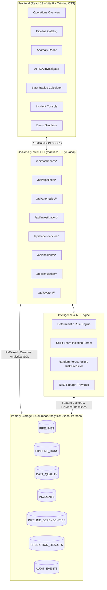

# DataPulse AI — Intelligent Data Pipeline Monitoring, Anomaly Detection & Root Cause Analysis

[](https://www.exasol.com)
[](https://www.exasol.com/personal/)
[](backend/tests/test_api.py)
[](frontend/)
[](LICENSE)

> **Predict failures. Explain incidents. Protect business data.**

---

## 1. Problem Statement — "The Work Behind the Work"

Data engineering and enterprise operations teams run hundreds of business-critical data pipelines every hour. However, when pipelines fail or degrade silently—producing incomplete batches, schema drifts, or severe freshness SLA breaches—teams spend hours manually grepping logs, hunting upstream dependencies, and firefighting downstream customer complaints.

**DataPulse AI** creates an end-to-end data observability and incident intelligence platform powered directly by **Exasol Personal Edition**. It detects operational anomalies across execution telemetry and data quality metrics, performs automated AI root-cause analysis backed by quantitative Exasol evidence, visualizes organizational blast radius, and provides an interactive disaster simulator for live demonstrations.

---

## 2. Core Architecture



---

## 3. Technology Stack

- **Primary Database Engine:** Exasol Personal Edition (`docker.io/exasol/nano:2026.2.0-nano.3`) on port `8563`.
- **Backend API:** Python 3.14, FastAPI 0.162, Pydantic v2, Uvicorn, PyExasol 3.0.
- **Machine Learning & Analytics:** Scikit-learn 1.9 (Isolation Forest, Random Forest), Pandas 3.0, NumPy 2.5.
- **Frontend Application:** React 19, Vite 8, Tailwind CSS, Recharts, Lucide React, React Router v7, Axios.
- **Testing & Verification:** Pytest (15/15 passing tests), Exasol 5-point verification script.

---

## 4. Key Functional Modules

| Module | Core Capabilities |
| :--- | :--- |
| **1. Operations Overview** | Real-time platform KPI cards, 14-day execution trends (Recharts), pipeline health distribution donut, and active incident stream. |
| **2. Pipeline Explorer** | Filterable catalog (by status, criticality, keyword), slide-out inspection drawer with 50-run telemetry history, data quality audits, and lineage links. |
| **3. Anomaly Radar** | Two-stage anomaly detection (deterministic rules + Scikit-Learn Isolation Forest) executed directly against Exasol telemetry vectors. |
| **4. AI Root Cause Analysis** | Automatic evidence compilation comparing current run against 14-day Exasol statistical baselines (Z-score deviation), detecting upstream culprits, and formulating remediation checklists. |
| **5. Lineage & Blast Radius** | Traverses directed dependency graphs in Exasol, calculates weighted Total Impact Score (0–100), and identifies impacted downstream executive reports. |
| **6. Incident Management** | Lifecycle management (Open, Acknowledged, Investigating, Resolved), resolution notes, and immutable audit logging in Exasol `AUDIT_EVENTS`. |
| **7. Demo Simulator** | 3 realistic production disaster scenarios (Missing Data, Execution Delay, Cascading Upstream Failure) + 1-click deterministic database reset. |
| **8. Exasol Health Cockpit** | 5/5 verification checklist, live latency monitor (~1.8 ms), table inventory verification, and ML model precision/recall metrics. |

---

## 5. Quick Start & Judge Reproduction Guide

### Prerequisites
- Python 3.10+ (tested on Python 3.14).
- Node.js 18+ and npm.
- Exasol Personal running locally or via container engine (Podman / Docker) on port `8563`.

### Step 1: Start Exasol Personal Container
If Exasol Personal is not running:
```bash
# Using Podman or Docker:
podman run -d --name exasol-datapulse -p 8563:8563 docker.io/exasol/nano:2026.2.0-nano.3
```

### Step 2: Environment Configuration
Copy the configuration template:
```bash
cp .env.example .env
```
Ensure `.env` contains:
```ini
EXASOL_DSN=127.0.0.1:8563
EXASOL_USER=sys
EXASOL_PASSWORD=exasol
EXASOL_SCHEMA=DATAPULSE
EXASOL_VERIFY_TLS=False
EXASOL_ENABLED=True
```

### Step 3: Initialize Schema & Seed Synthetic Data
```bash
# Create DATAPULSE schema and 7 core tables in Exasol:
python backend/scripts/init_db.py

# Populate deterministic historical pipeline runs, dependencies, and quality records:
python backend/scripts/generate_synthetic_data.py
```

### Step 4: Verify Database Connectivity
```bash
python backend/scripts/test_exasol.py
```
Expected output:
```
[1/5] Testing physical connection to Exasol... [OK]
[2/5] Executing 'SELECT 1' ping test... [OK]
[3/5] Querying Exasol metadata... [OK] (Version: 2026.2.0-nano.3)
[4/5] Verifying schema 'DATAPULSE' and required tables... [OK] (7/7 tables verified)
[5/5] Executing sample analytical SQL query... [OK]
[SUCCESS] Exasol Personal connectivity and database verification passed!
```

### Step 5: Run Backend Automated Test Suite
```bash
python -m pytest backend/tests/test_api.py -v
```
*(All 15 tests validate live against Exasol Personal with 100% pass rate).*

### Step 6: Start the Application

**Terminal 1 — Backend API Server:**
```bash
python -m uvicorn backend.app.main:app --host 0.0.0.0 --port 8000 --reload
```
API docs available at: `http://localhost:8000/docs`

**Terminal 2 — Frontend UI:**
```bash
cd frontend
npm run dev
```
Open your browser at: `http://localhost:5173`

---

## 6. Project Directory Structure

```
Exasol_project/
├── .env.example                       # Template environment configuration
├── .gitignore                         # Excludes secrets, node_modules, and cache
├── LICENSE                            # MIT Open Source License
├── README.md                          # Project documentation
├── backend/
│   ├── app/
│   │   ├── api/
│   │   │   └── endpoints.py           # 17 RESTful API endpoints
│   │   ├── core/
│   │   │   └── config.py              # Pydantic Settings & environment validation
│   │   ├── database/
│   │   │   └── exasol_client.py       # PyExasol connector with retries & health checks
│   │   ├── models/
│   │   │   └── schemas.py             # Pydantic v2 data models
│   │   ├── services/
│   │   │   ├── dashboard_service.py   # Exasol windowed metrics & trend aggregations
│   │   │   ├── pipeline_service.py    # Pipeline catalog & run histories
│   │   │   ├── anomaly_service.py     # Deterministic rules + Isolation Forest
│   │   │   ├── prediction_service.py  # Random Forest failure risk predictor
│   │   │   ├── investigation_service.py# AI Root Cause Analysis engine
│   │   │   ├── dependency_service.py  # DAG blast radius calculator
│   │   │   ├── incident_service.py    # Incident lifecycle & audit logging
│   │   │   └── simulator_service.py   # Disaster scenario injection into Exasol
│   │   └── main.py                    # FastAPI application entrypoint & lifespan
│   ├── scripts/
│   │   ├── init_db.py                 # Schema & table creation script
│   │   ├── generate_synthetic_data.py # Deterministic telemetry data generator
│   │   └── test_exasol.py             # 5-step Exasol verification diagnostic
│   └── tests/
│       └── test_api.py                # 15 end-to-end integration tests
├── database/
│   └── schema.sql                     # Exasol SQL DDL for DATAPULSE schema
├── docs/
│   ├── ARCHITECTURE.md                # System design & data flow specification
│   ├── DEMO_GUIDE.md                  # Step-by-step judge run guide & evaluation flow
│   ├── DEPLOYMENT.md                  # Production deployment & service orchestration
│   ├── EXASOL_ANALYTICS.md            # Detailed catalog of all analytical SQL queries
│   └── EXASOL_SETUP.md                # Step-by-step Exasol deployment guide
├── frontend/
│   ├── src/
│   │   ├── api/client.js              # Axios service wrapper
│   │   ├── components/Layout.jsx      # Navigation sidebar & live Exasol status pill
│   │   ├── pages/
│   │   │   ├── OverviewPage.jsx       # Operations Dashboard
│   │   │   ├── PipelinesPage.jsx      # Pipeline Catalog & run inspector
│   │   │   ├── AnomaliesPage.jsx      # Anomaly Radar & ML scoring
│   │   │   ├── InvestigationPage.jsx  # AI Root Cause Analysis
│   │   │   ├── LineagePage.jsx        # Lineage & Blast Radius
│   │   │   ├── IncidentsPage.jsx      # Incident Console & Audit Log
│   │   │   ├── SimulatorPage.jsx      # Live Disaster Scenario Simulator
│   │   │   └── SystemPage.jsx         # Exasol Health Cockpit
│   │   ├── App.jsx                    # React Router configuration
│   │   ├── index.css                  # Tailwind CSS styling
│   │   └── main.jsx                   # Application entrypoint
│   └── package.json
└── submission/
    ├── pitch_deck/
    │   ├── DataPulse_AI_Pitch_Deck.pptx# Official PowerPoint Presentation Deck
    │   └── pitch_deck.md              # Markdown transcript of 10-slide deck
    ├── demo_script.md                 # 3-minute video demonstration script
    └── submission_checklist.md        # Comprehensive Hackathon criteria audit
```

---

## 7. Submission Deliverables

- **Pitch Deck (PowerPoint PPTX):** [`submission/pitch_deck/DataPulse_AI_Pitch_Deck.pptx`](submission/pitch_deck/DataPulse_AI_Pitch_Deck.pptx)
- **Pitch Deck (Markdown):** [`submission/pitch_deck/pitch_deck.md`](submission/pitch_deck/pitch_deck.md)
- **3-Minute Demo Video Script:** [`submission/demo_script.md`](submission/demo_script.md)
- **Judge Run Guide:** [`docs/DEMO_GUIDE.md`](docs/DEMO_GUIDE.md)
- **Deployment Instructions:** [`docs/DEPLOYMENT.md`](docs/DEPLOYMENT.md)
- **Analytical SQL Query Catalog:** [`docs/EXASOL_ANALYTICS.md`](docs/EXASOL_ANALYTICS.md)
- **Verification Checklist:** [`submission/submission_checklist.md`](submission/submission_checklist.md)
- **Exasol Setup Guide:** [`docs/EXASOL_SETUP.md`](docs/EXASOL_SETUP.md)

---

## 8. License

This project is licensed under the terms of the [MIT License](LICENSE).
