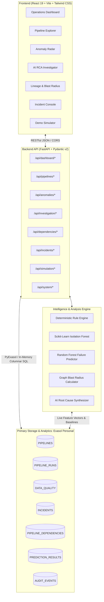
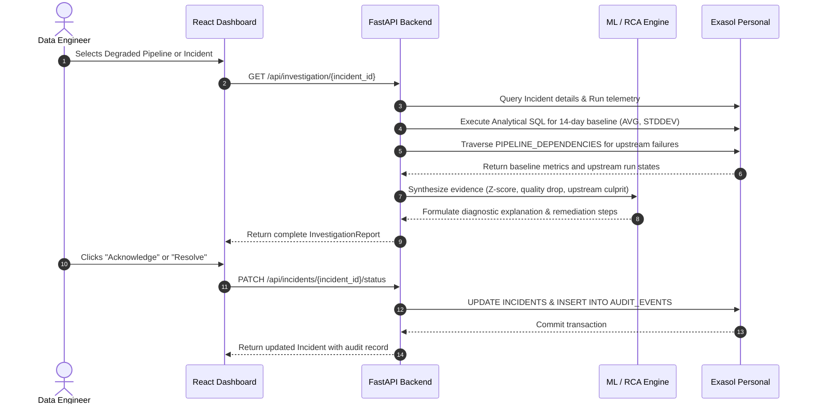

# DataPulse AI — System Architecture & Design

**ExaThon India 2026 — Track 04: The Work Behind the Work**  
**Project:** DataPulse AI — Intelligent Data Pipeline Monitoring, Anomaly Detection and Root Cause Analysis

---

## 1. System Overview

DataPulse AI is a modern data observability and incident intelligence platform designed to eliminate pipeline blindspots in complex enterprise data architectures.

---

## 2. Component Architecture

### A. Frontend Layer
- **Framework:** React 19 with Vite 8.
- **Styling:** Tailwind CSS (Dark Enterprise Palette — `#0B1120`, `#1E293B`, `#38BDF8`, `#818CF8`).
- **Data Visualization:** Recharts (time-series multi-line graphs, area charts, bar charts, custom gauges).
- **Icons:** Lucide React.
- **Routing:** React Router v7.
- **State & Communication:** Axios with live Exasol ping monitor.

### B. Backend API Layer
- **Framework:** FastAPI with Uvicorn async server.
- **Data Validation:** Pydantic v2 strict models (`schemas.py`).
- **Connection Management:** `exasol_client.py` with exponential backoff, persistent pooling, TLS configuration, and health ping telemetry.
- **Service Modularization:**
  - `dashboard_service.py`: High-performance windowed metrics and historical trend aggregations.
  - `pipeline_service.py`: Pipeline catalog, run histories, and data quality indicators.
  - `anomaly_service.py`: Two-stage deterministic + unsupervised anomaly detection.
  - `prediction_service.py`: Supervised failure risk scoring and model validation metrics.
  - `investigation_service.py`: Multi-source evidence compilation and AI root-cause diagnosis.
  - `dependency_service.py`: DAG traversal, BFS blast radius computation, and affected business reports mapping.
  - `incident_service.py`: Incident lifecycle transitions and immutable audit event logging.
  - `simulator_service.py`: Live failure scenario injection into Exasol.

### C. Primary Database Engine: Exasol Personal
- **Engine Version:** Exasol Personal `2026.2.0-nano.3`.
- **Port:** `8563`.
- **Schema:** `DATAPULSE`.
- **Role:** Mandatory primary database powering all persistence, time-series aggregation, and analytical SQL. No in-memory cache or relational substitutes are used for application data.

---

## 3. Data Flow

### Anomaly Detection & Investigation Flow

---

## 4. Security & Compliance
- **Zero Hardcoded Secrets:** Credentials loaded exclusively via `.env` with fallback validation in `backend/app/core/config.py`.
- **Public GitHub Readiness:** Gitignore excludes `.env`, logs, local scratch files, node_modules, and cache files.
- **Immutable Audit Trail:** All operator interventions, status transitions, and notes are appended to `DATAPULSE.AUDIT_EVENTS` with operator attribution and ISO timestamps.
